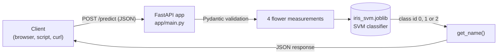
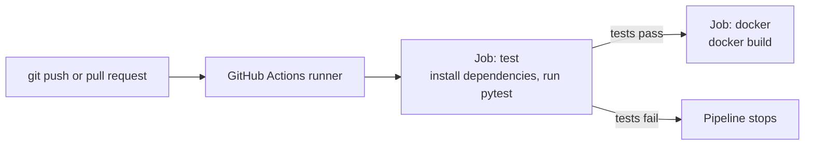

<div align="center">

# 🌸 Iris SVM Prediction API

**A machine learning model served with FastAPI, packaged with Docker and validated by a GitHub Actions CI pipeline.**

[](https://github.com/hamzaX12/iris-svm/actions/workflows/ci.yml)


[Overview](#overview) •
[Architecture](#architecture) •
[Getting Started](#getting-started) •
[API Usage](#api-usage) •
[CI/CD Pipeline](#cicd-pipeline)

</div>

---

## Table of Contents

- [Overview](#overview)
- [Architecture](#architecture)
- [Project Structure](#project-structure)
- [Data Dictionary](#data-dictionary)
- [Getting Started](#getting-started)
- [API Usage](#api-usage)
- [Testing](#testing)
- [CI/CD Pipeline](#cicd-pipeline)
- [Roadmap](#roadmap)
- [Author](#author)

---

## Overview

This project takes a trained **SVM classifier** on the classic Iris dataset and turns it into a small production-style service:

- **Model**: an SVM saved with `joblib` (`iris_svm.joblib`).
- **API**: a FastAPI application that loads the model and exposes a `/predict` endpoint.
- **Container**: a Docker image that packages the API and the model.
- **CI**: a GitHub Actions workflow that runs the tests and builds the Docker image on every push.

Given four flower measurements, the API returns the predicted species: `setosa`, `versicolor` or `virginica`.

The goal of the project is to understand the full path from a trained model to a tested, containerized API.

---

## Architecture

### Request flow



### CI pipeline



---

## Project Structure

| Path | Description |
|------|-------------|
| `app/main.py` | FastAPI application: loads the model, defines `/health` and `/predict` |
| `app/__init__.py` | Empty file that makes `app` an importable package |
| `tests/test_api.py` | Automated API tests run with pytest |
| `iris_svm.joblib` | Trained SVM model |
| `requirements.txt` | Python dependencies |
| `Dockerfile` | Instructions to build the container image |
| `.github/workflows/ci.yml` | GitHub Actions workflow (test, then Docker build) |

---

## Data Dictionary

### Input features (request body)

| Field | Type | Unit | Description |
|-------|------|------|-------------|
| `sepal_length` | float | cm | Length of the sepal |
| `sepal_width` | float | cm | Width of the sepal |
| `petal_length` | float | cm | Length of the petal |
| `petal_width` | float | cm | Width of the petal |

### Output (response body)

| Field | Type | Description |
|-------|------|-------------|
| `class_id` | integer | Class predicted by the model |
| `name` | string | Species name matching the class id |

### Class mapping

| `class_id` | `name` |
|:----------:|--------|
| 0 | setosa |
| 1 | versicolor |
| 2 | virginica |

---

## Getting Started

### Prerequisites

- Python 3.11 (or a version compatible with your installed scikit-learn)
- Docker (optional, to run the container)
- Git

### Run locally

```bash
# 1. Clone the repository
git clone https://github.com/hamzaX12/iris-svm.git
cd iris-svm

# 2. Install dependencies
python -m pip install -r requirements.txt

# 3. Start the API
python -m uvicorn app.main:app --reload
```

The interactive documentation is then available at <http://127.0.0.1:8000/docs>.

> **Note:** `requirements.txt` pins `scikit-learn==1.6.1`, the version used to train the model. Loading a model with a different scikit-learn version can trigger an `InconsistentVersionWarning`.

### Run with Docker

```bash
# Build the image
docker build -t iris-svm-api .

# Run the container
docker run -p 8000:8000 iris-svm-api
```

The API is then available at <http://127.0.0.1:8000/docs>.

---

## API Usage

### Endpoints

| Method | Endpoint | Description |
|--------|----------|-------------|
| `GET` | `/health` | Checks that the API is running |
| `POST` | `/predict` | Returns the predicted Iris species |
| `GET` | `/docs` | Interactive Swagger documentation |

### Request example

```json
{
  "sepal_length": 5.1,
  "sepal_width": 3.5,
  "petal_length": 1.4,
  "petal_width": 0.2
}
```

### Response example

```json
{
  "class_id": 0,
  "name": "setosa"
}
```

### Send a request

**Python**

```python
import requests

data = {
    "sepal_length": 5.1,
    "sepal_width": 3.5,
    "petal_length": 1.4,
    "petal_width": 0.2,
}

response = requests.post("http://127.0.0.1:8000/predict", json=data)
print(response.json())
```

**curl (Linux, macOS, Git Bash)**

```bash
curl -X POST http://127.0.0.1:8000/predict \
  -H "Content-Type: application/json" \
  -d '{"sepal_length": 5.1, "sepal_width": 3.5, "petal_length": 1.4, "petal_width": 0.2}'
```

**PowerShell**

```powershell
Invoke-RestMethod -Uri http://127.0.0.1:8000/predict -Method Post `
  -ContentType "application/json" `
  -Body '{"sepal_length":5.1,"sepal_width":3.5,"petal_length":1.4,"petal_width":0.2}'
```

### Sample inputs

| sepal_length | sepal_width | petal_length | petal_width | Typical species |
|:------------:|:-----------:|:------------:|:-----------:|-----------------|
| 5.1 | 3.5 | 1.4 | 0.2 | setosa |
| 6.0 | 2.9 | 4.5 | 1.5 | versicolor |
| 6.5 | 3.0 | 5.8 | 2.2 | virginica |

---

## Testing

Run the test suite from the project root:

```bash
python -m pytest tests/ -v
```

> Use `python -m pytest` rather than plain `pytest`. It adds the project root to Python's path so that `from app.main import app` works.

---

## CI/CD Pipeline

The workflow in `.github/workflows/ci.yml` runs on every push and pull request to `main`.

| Job | Purpose | Runs when |
|-----|---------|-----------|
| `test` | Installs dependencies and runs the pytest suite | Every push and pull request |
| `docker` | Builds the Docker image to confirm the Dockerfile is valid | Only if `test` succeeds |

```yaml
name: CI

on:
  push:
    branches: [main]
  pull_request:
    branches: [main]

jobs:
  test:
    runs-on: ubuntu-latest
    steps:
      - uses: actions/checkout@v4
      - uses: actions/setup-python@v5
        with:
          python-version: "3.11"
      - run: pip install -r requirements.txt
      - run: python -m pytest tests/ -v

  docker:
    needs: test
    runs-on: ubuntu-latest
    steps:
      - uses: actions/checkout@v4
      - run: docker build -t iris-svm-api:latest .
```

> The `docker` job builds the image on a temporary GitHub runner to verify that it builds correctly. The image is not published anywhere yet.

---

## Roadmap

- [ ] Publish the Docker image to GitHub Container Registry
- [ ] Add linting with `ruff` to the CI pipeline
- [ ] Add a model quality check that fails the pipeline if accuracy drops
- [ ] Add input range validation to the request model

---

## Author

<div align="center">

**Hamza**

[](https://www.linkedin.com/in/hamza-ben-allou-48ab31236)
[](https://github.com/hamzaX12)

</div>
